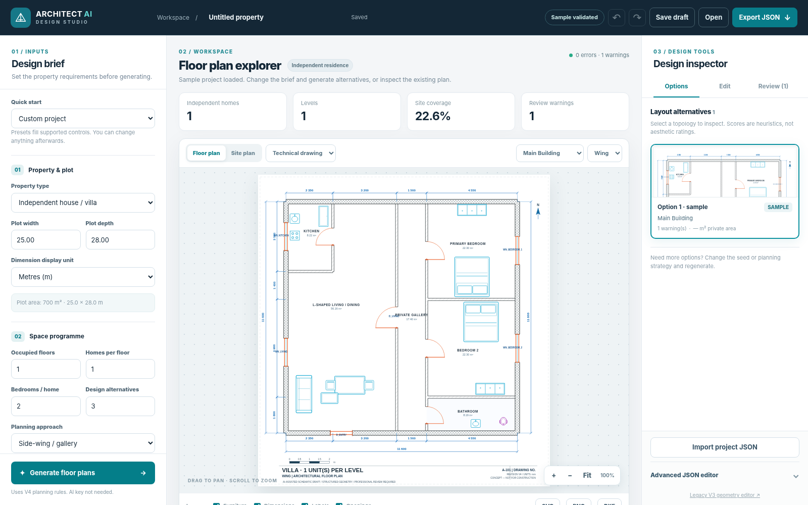
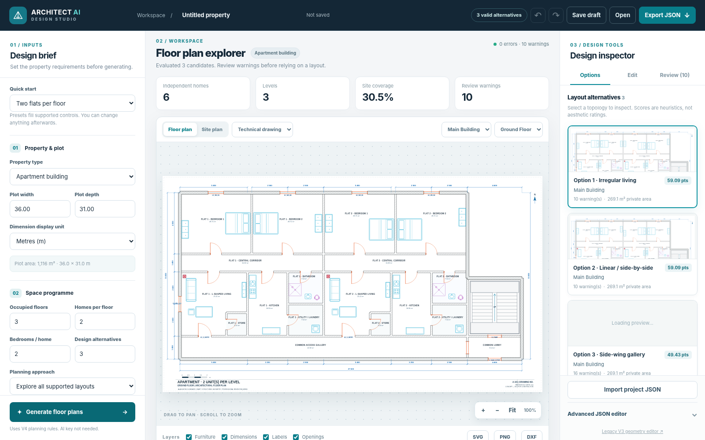
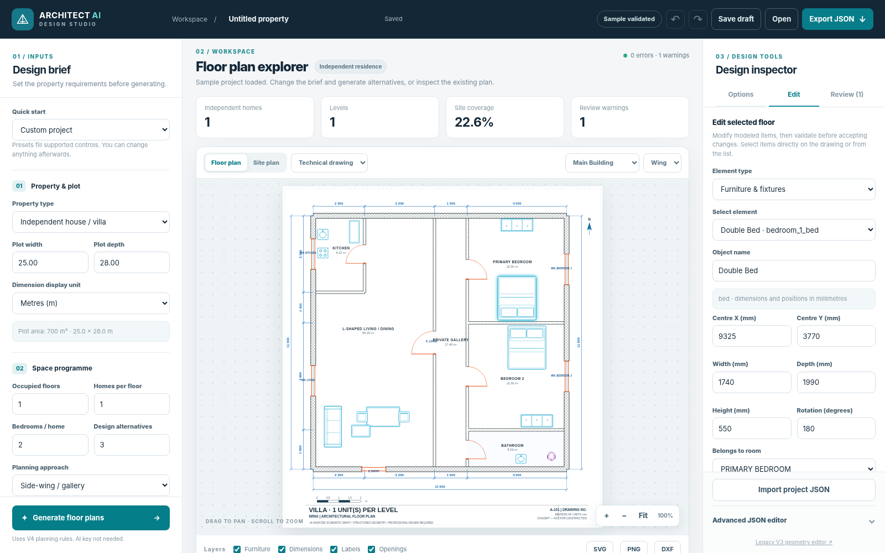
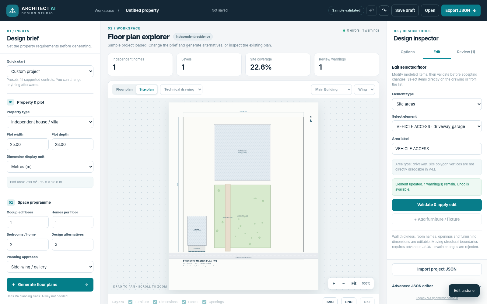

# Architect AI Studio

**Property-scale 2D architectural concept generation, inspection, editing, and CAD export.**  
Current bundled build: **V4.1** (V4 property engine + revised web UI).



> **Concept design software, not construction documentation.** Generated drawings are not approved building plans. Geometry checks are incomplete; use a qualified architect and engineers for structural, fire, accessibility, MEP, site and regulatory decisions.

## Explore the application

| Alternate designs | Element editing | Site planning |
|---|---|---|
|  |  |  |

**Mobile:** [Plan-first interface](docs/screenshots/mobile-plan.png) · [Property brief controls](docs/screenshots/mobile-brief.png)  
**More screenshots:** [Gallery](docs/SCREENSHOTS.md) · **Quick walkthrough:** [User Guide](docs/USER_GUIDE.md)

## Start locally

Requires Python **3.11+**, Git only if you plan to publish/clone, and a modern browser. Commands below run from the repository root.

```bash
python -m pip install -r requirements.txt
python app.py
```

Open **http://127.0.0.1:8000**. On Windows, use `py` instead of `python` if appropriate. For a guided Windows start, double-click **`Start_Architect_AI_Studio.bat`**; it creates a local `.venv`, installs dependencies, and starts the server. No Gemini API key is needed to generate offline property alternatives.

**Optional Gemini brief interpretation:**

```powershell
# Windows PowerShell (only if you want natural-language brief parsing)
$env:GEMINI_API_KEY="YOUR_KEY"
py app.py
```

```bash
# macOS / Linux alternative
export GEMINI_API_KEY="YOUR_KEY"
python app.py
```

Never commit your API key. The browser talks to the local Python backend; the Gemini key stays server-side.

## Generate your first plan

1. Open **Design brief** and choose **Quick start**, or select one of the four **Property types**.
2. Set **Plot width/depth** and their displayed units. The source model always stores millimetres.
3. Choose **Occupied floors**, **Homes per floor**, **Bedrooms / home**, and **Design alternatives** (1-5).
4. Choose the **Planning approach**. With **Explore all supported layouts**, the engine searches multiple predefined layout families.
5. Set **Staircase, Lift, Garage, Garden, Shaft** to **Auto**, **Include** or **Exclude**; enter open parking and accessibility preference as needed.
6. Click **Generate floor plans**. Select a card under **Options** in the right-hand **Design inspector**.
7. Change **Floor plan / Site plan**, **Technical drawing / Furnished view**, the current building/level, and visible layers; pan/zoom as needed.
8. In **Edit**, select a modeled item and change its permitted properties. Changes are checked before acceptance. Use **Undo / Redo**.
9. Review the **Review** tab for warnings and limitations. **Save draft** stores a browser-local copy; **Export JSON** preserves the project; **SVG/PNG/DXF** provide drawing exports.

**Important UI limits:** No full CAD wall-topology dragging, no certified code checking, no cloud project sync, no complete 3D renderer. The **Gemini brief tool** translates natural language into property settings; the geometric generator remains deterministic/heuristic.

## Included property types

| Type | Illustrated output | Support |
|---|---|---|
| Independent houses and villas | [Villa + site](examples/v4_sample_property_site.svg) | 1-4 bedrooms, garage/lawn/parking options, multi-storey concepts |
| Apartment buildings | [Two flats](examples/v4_two_flats_floor.svg) | Independent flats, shared gallery, optional stair/lift core |
| Duplex residences | [Vertical-core example](examples/vertical_core_2level.svg) | One home with linked levels |
| Mixed-use developments | [Retail + residences](examples/v4_mixed_use_floor.svg) | Basic ground-floor commercial + upper residential layout |

**Generated catalog:** [35 property scenarios / 92-page illustrated PDF](showcase/catalog/Architect_AI_Studio_V4_35_Examples.pdf) · [Source JSON/SVG and validation reports](showcase/catalog/) · [Catalog guide](docs/EXAMPLE_CATALOG.md). The catalog contains **26 distinct base-floor geometries**, not 35 unique architectural topologies. Some cases have warnings, particularly for external windows.

## What the engine does

- **Deterministic, parameterized generator:** selects from implemented arrangement families based on a property request and a seed; the same inputs and code version aim to reproduce the same layout. It does **not** learn or invent unlimited new architectural typologies.
- **Property hierarchy:** plot → buildings → floors → private units / common spaces → rooms, walls, openings, fixtures and furniture.
- **Geometry and property validation:** checks implemented collisions, access, site compatibility and ownership constraints. A successful check does not establish regulatory compliance, aesthetics, structural stability or general usability.
- **Comparative search:** explores candidates, filters invalid ones, and sorts survivors using heuristics such as circulation efficiency and window opportunities (not an architectural beauty score).
- **Gemini (optional):** parses a written user brief into typed property parameters; it does not perform guaranteed architectural design.
- **Export:** SVG, PNG, DXF and canonical JSON; the retained geometry also supports future 3D work.

See [Architecture & limitations](docs/ARCHITECTURE.md), [V4 property contract](PROPERTY_BLUEPRINT_V4.md), and [V3 geometry contract](ARCHITECTURE_BLUEPRINT.md).

## Testing and provenance

```bash
python -m pytest tests/test_v4.py -v
python -m pytest tests/test_v3.py -v
```

Tests are checked into [`tests/`](tests/) and automated through [GitHub Actions](.github/workflows/tests.yml). **The 44 retained Python tests passed in the packaged local run** ([JUnit XML and limitations](docs/TESTING.md)); the GitHub Actions job has not run until publication. The screenshots show the actual Chromium-rendered V4.1 interface, with HTTP requests routed to its local FastAPI backend during capture—not AI mockups. The 35-plan catalog was exported by the original V4 generator (the V4.1 UI builds on this same engine).

## References

- [Full step-by-step user guide](docs/USER_GUIDE.md)
- [Interface screenshot gallery](docs/SCREENSHOTS.md)
- [35-case architectural examples](docs/EXAMPLE_CATALOG.md)
- [System architecture and deterministic generation](docs/ARCHITECTURE.md)
- [Test and validation report](docs/TESTING.md)
- [Publishing to GitHub](docs/PUBLISHING.md)
- [UI audit / V4.1 changes](UI_V4_1_AUDIT.md)
- Interactive OpenAPI at **http://127.0.0.1:8000/docs** after starting the server

**Licensing:** No license has yet been granted for this source repository. Choose a suitable license after reviewing commercial plans and third-party code/data obligations; the absence of a license is intentional, not a claim that the repository is open-source.
