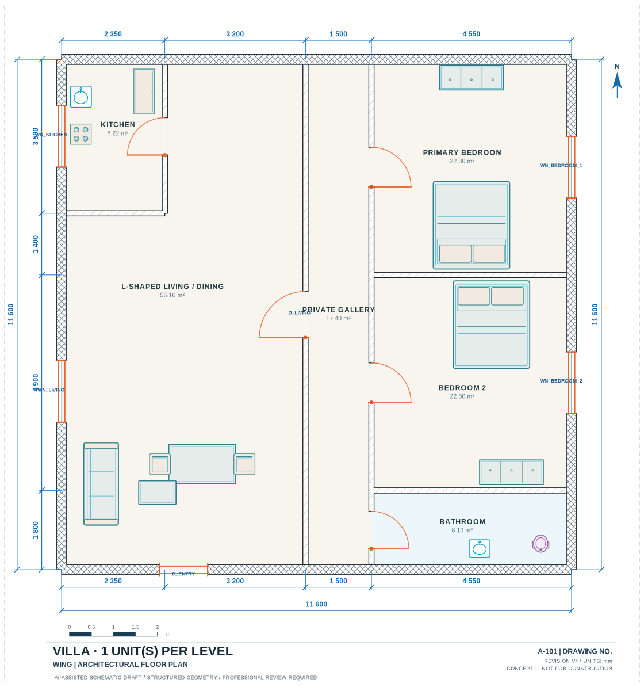
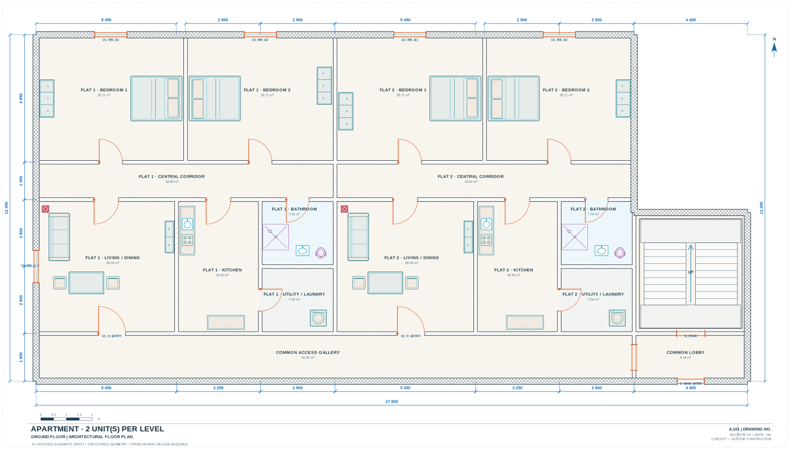
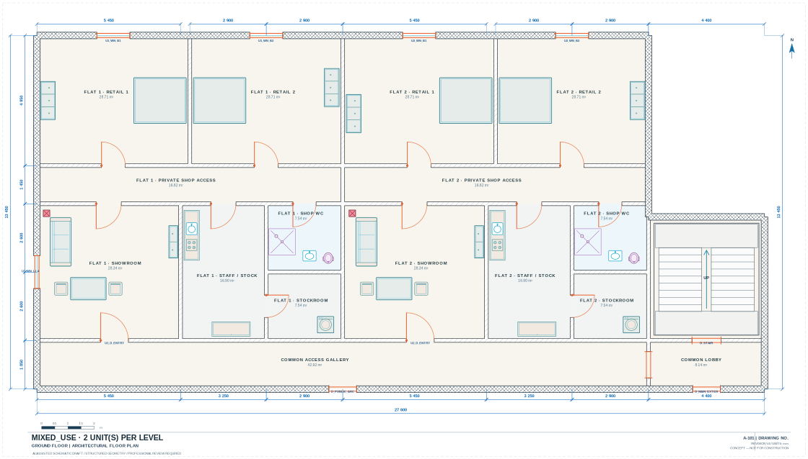

# Generated architectural example catalog

This repository bundles the original V4 generator's **35 scenario catalog** in `showcase/catalog/`:

- [Illustrated vector PDF: 92 A3 landscape pages](../showcase/catalog/Architect_AI_Studio_V4_35_Examples.pdf)
- [CSV index of all scenarios](../showcase/catalog/catalog_index.csv)
- [Machine-readable catalog manifest](../showcase/catalog/catalog_manifest.json)
- [Original generation script](../showcase/catalog/reproduce_examples.py)
- `showcase/catalog/V01/` ... `M07/` — project JSON, site SVG, relevant floor SVG(s), validation reports

There are **35 request scenarios** but only **26 distinct base-floor geometries**. The four supported property categories in this catalog are independent homes/villas (11), duplex residences (3), apartments (14), and mixed-use projects (7).

## Representative designs

| Villa floor | Apartments / shared corridor | Mixed use |
|---|---|---|
|  |  |  |

## About the validation reports

All 35 catalog scenarios passed the original V4 validator's **implemented error checks**, but **27 cases had warnings**. In particular, 25 scenarios flagged missing modeled external windows and other cases include lift/parking or furnishing concerns. Passing a validator is **not** a building permit, construction drawing, or proof of a good design.

To reproduce, follow [showcase/catalog/README.md](../showcase/catalog/README.md). The catalog was produced from the V4 generation code, not manually redrawn to create attractive examples.
