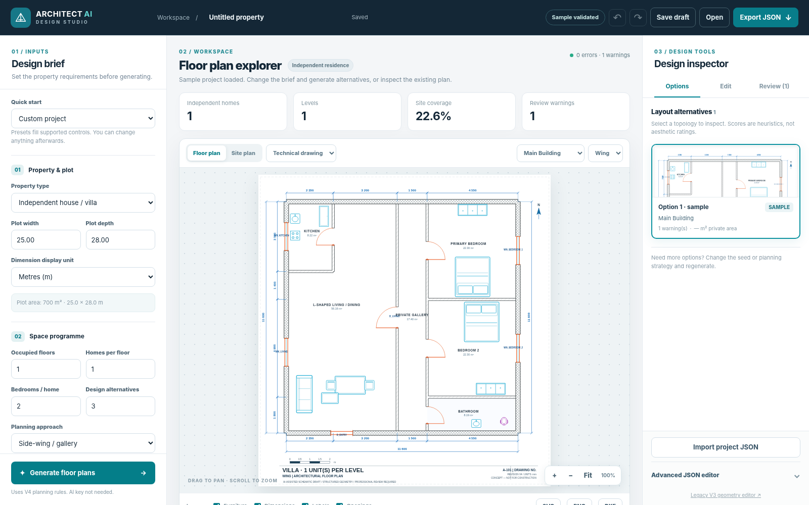
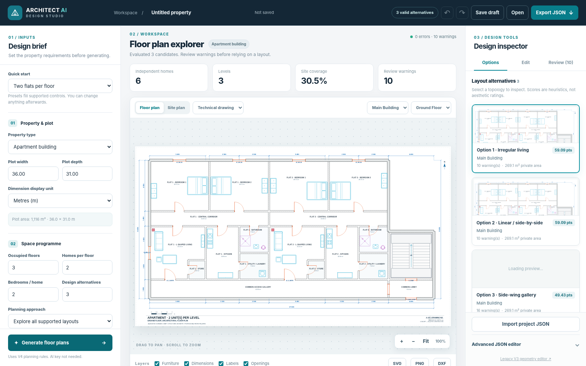
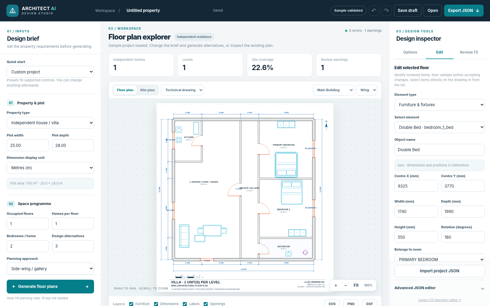
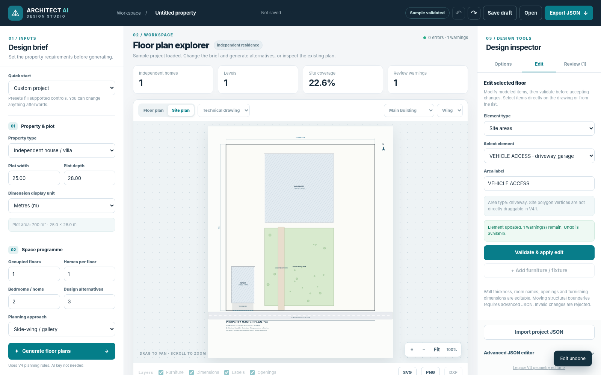
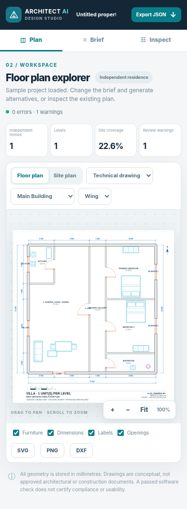
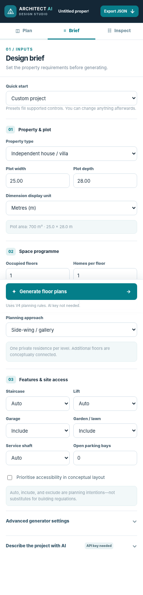

# Actual V4.1 interface screenshots

All images below were captured from the actual V4.1 HTML/CSS/JavaScript running in Chromium, with requests routed to the local FastAPI application; **none are generated UI mockups**. See `UI_V4_1_AUDIT.md` for the capture and testing limitations.

## Desktop — design workspace

## Comparison — alternative floor plans

## Element editing — validated property inspector

## Site planning — plot, outdoor areas and footprint

## Mobile — plan-first view

## Mobile — brief and generation controls

