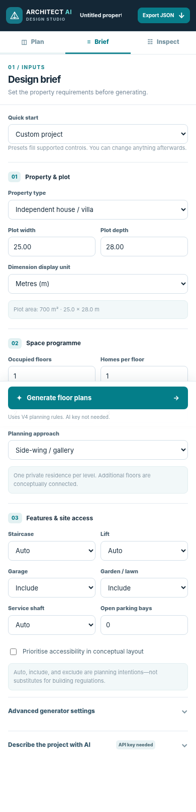
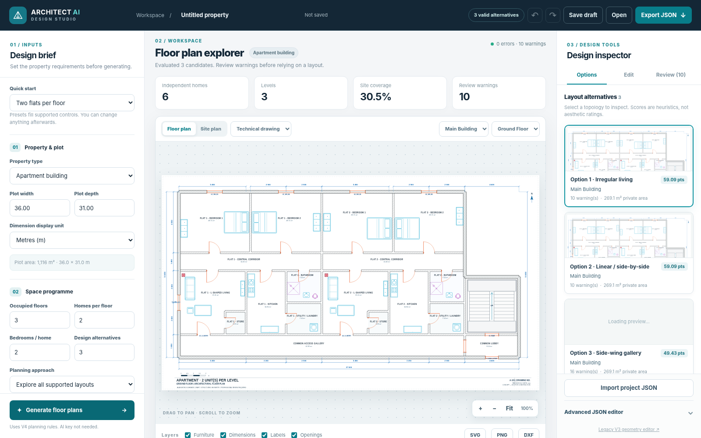
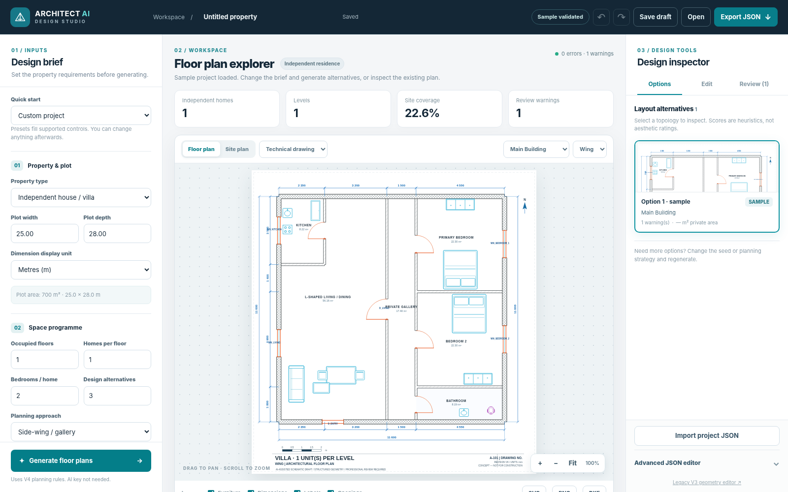
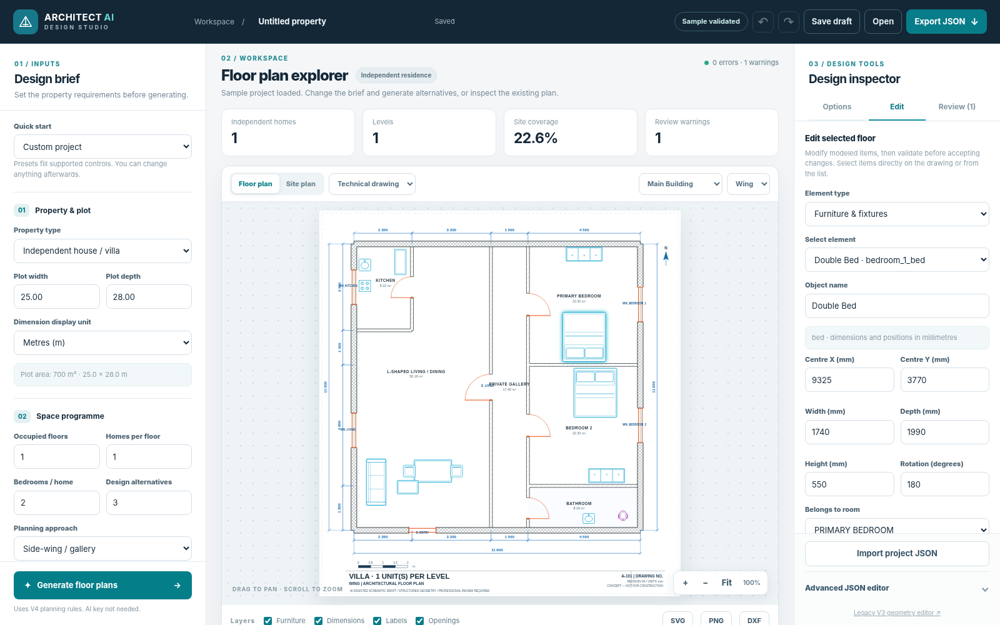
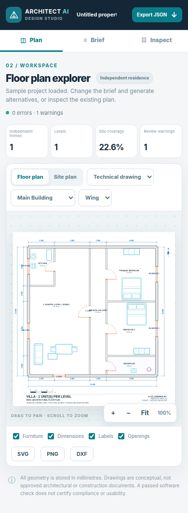

# User guide — Architect AI Studio V4.1

This guide follows the *actual controls in* `static/v4.html` and the current FastAPI backend. All projects are **conceptual designs**, not approved architectural plans.

## 1. Install and open

1. Install Python 3.11 or newer.
2. Open a command prompt in the project root. Run `python -m pip install -r requirements.txt` (or `py -m pip ...` on Windows). **Windows shortcut:** double-click `Start_Architect_AI_Studio.bat` to create a project virtual environment, install requirements, and start the server automatically.
3. Run `python app.py` (or `py app.py`).
4. Open `http://127.0.0.1:8000` in a browser. The application loads a sample property automatically.
5. If the server prints a Python exception, fix that first; the frontend depends on the FastAPI backend and cannot produce drawings on its own.

**Keyless mode:** The default generator, viewer, editing, validation and exports do **not** need an API key. To enable *Describe the project with AI*, set `GEMINI_API_KEY` in your operating-system environment **before** starting the app. The button is disabled when no key is detected. Live Gemini success depends on API access and has not been independently certified.

## 2. Choose the property requirements (left side: Design brief)

**Quick start** offers six presets: Independent home + garden; Irregular L-shaped home; Two flats per floor; Four flats per floor; Two-level duplex; Retail + apartments. Presets populate controls; they do not bypass validation.

**Property & plot**: choose one of Villa, Apartment, Duplex, or Mixed-use; enter **Plot width** and **Plot depth**. Use the **Dimension display unit** dropdown for metres, feet, or millimetres. The internal project JSON always uses millimetres.

**Space programme**: enter **Occupied floors** (1–6), **Homes per floor** (1–4), **Bedrooms / home** (1–4), and **Design alternatives** (1–5). Select **Planning approach**: Auto, Linear/side-by-side, Opposed flats/corridor, Side-wing/gallery, or Irregular L-shaped living. Some strategies are only applicable to certain property requests; incompatible requests show a feasibility error.

**Features & site access**: for Staircase, Lift, Garage, Garden/Lawn and Service Shaft, choose **Auto**, **Include**, or **Exclude**. Open parking bays are an integer (0–12). Accessibility priority is a planning preference, **not** an accessibility compliance test. For example, automatic multi-level circulation is not the same thing as a certified egress strategy.

**Advanced generator settings** contains the **Variation seed** (reproducible alternative selection) and **Concept margin** in millimetres (an illustrative site constraint, not a building regulation).

## 3. Generate and compare alternatives

1. Click **Generate floor plans** at the bottom of the brief panel.
2. Wait for results in **Design inspector → Options** on the right.
3. Click an alternative card to load that exact model and its architectural review report. An alternative's numeric score is a *heuristic comparison*, not professional grading.
4. Choose a different **Planning approach** or **Variation seed**, then regenerate if you need other candidates.

**Why a request may fail:** A plot can be physically too small, incompatible with the chosen plan family, or request mutually contradictory features (for example, multiple occupied floors with stairs forbidden and no supported substitute). The app is designed to reject rather than silently shrink everything.

## 4. Read the drawing (central workspace)

| Control | What it does |
|---|---|
| **Floor plan / Site plan** | Switch between a measured floor drawing and plot arrangement |
| **Technical drawing / Furnished view** | Toggle drafting presentation style |
| **Building / Floor** | Inspect the selected structure and level |
| **Zoom +, −, Fit** | Magnify and fit view; drag to pan, scroll to zoom |
| **Furniture / Dimensions / Labels / Openings** | Show or hide those SVG layers (view only) |
| **SVG / PNG / DXF** | Download available drawing formats; DXF is floor-oriented |

### Inspect a multi-storey or multi-unit project

Choose the building and level with the two dropdowns above the drawing. Apartment/shared spaces are represented as modeled geometry, not separate screenshots pasted together. Site views are for plot context; edit a specific level to adjust its rooms or fittings.

## 5. Edit modeled items and apply validation

1. Open **Design inspector → Edit**.
2. Click a selectable SVG object, or choose an **Element type** then **Select element**.
3. Change the permitted fields shown in **Edit selected floor**.
4. Click **Validate & apply edit**. The backend checks the changed property; invalid changes are rejected with feedback.
5. Use **Undo / Redo** for accepted changes (also available as mobile controls).

**Supported in the inspector:** Furniture and fixtures (position, dimensions, rotation); door/window offsets and dimensions; selected wall dimensions and heights; room names/ceiling heights; site-area labels. **Add furniture/fixture** runs a bounded placement search and may refuse a new item. The inspector does **not** yet move shared room boundaries, redraw a whole room topology, or solve all interior-design requirements.

The **Advanced JSON editor** allows manual edits to the canonical property structure, but requires schema knowledge. Invalid JSON/models are rejected. Make a backup first.

## 6. Review, save and export

**Review tab:** Shows implemented validation outcomes and included/excluded feature decisions. A zero-error result only means the current *implemented checks* passed, not that a building is buildable or code-compliant.

**Save draft**: stores a browser-local project draft (up to 12). **Open** restores browser-local drafts on the same browser/device. This is **not cloud sync**. For durable project transfer or backup, use **Export JSON**; restore it using **Import project JSON**. The **project name** is editable in the top bar.

**SVG** remains scalable; **PNG** suits previews and communication; **DXF** suits workflows in CAD tools; **JSON** is the authoritative model for later edits or 3D work. Site views may have different export availability from floor views.

## 7. Mobile use

The mobile application is a responsive website, not a separately installed mobile app. Use **Plan / Brief / Inspect** tabs. **Plan** opens first so the drawing is always easy to find. The mobile inspector includes draft actions and Undo/Redo.

## 8. Common questions

**Do I need Gemini?** No. The default engine is deterministic; Gemini *interprets the brief* if configured. It does not turn this app into a professional architectural design AI.

**What does deterministic mean?** The Python generator follows programmed geometric arrangements and rules. Given the same requirements, seed, and software version, it aims to return the same result. AI image generation is not involved in placing the walls.

**Why are alternatives sometimes similar?** Only a bounded number of layouts are currently programmed. Different seeds can vary parameters without producing a wholly new architectural typology.

**Can I move walls freely by dragging?** Not yet. Element editing is available, while room-topology editing requires JSON/manual development.

**Why does a drawing show a warning?** The validator has detected an issue or an unverified quality measure. Warnings should be reviewed rather than assumed harmless.

**Does this make construction-ready plans?** No. Professional site, fire, structural, accessibility, ventilation, MEP and jurisdiction-specific checks remain necessary.
